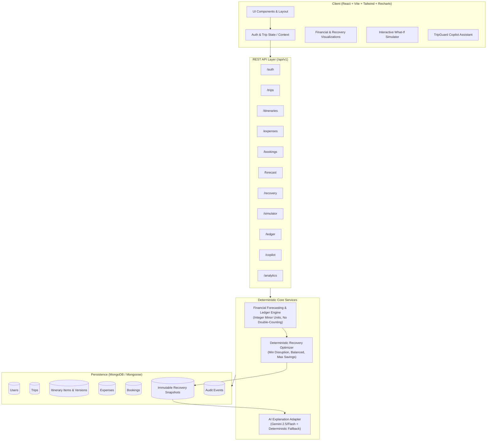

# TripGuard — System Architecture Specification

**Product Tagline:** Save your trip. Not just your budget.  
**System Classification:** Adaptive Travel Budget & Itinerary Recovery Intelligence Platform  
**Architecture Pattern:** Modular Monolith with Decoupled Frontend (SPA) & Deterministic Optimization Core  

---

## 1. System Overview & Component Hierarchy

TripGuard is architected as a clean modular monolith consisting of:
1. **Frontend Client (`/client`):** High-performance React 18/19 SPA built with Vite, TypeScript, Tailwind CSS, Recharts, and Lucide icons. Implements the *Premium Hybrid SaaS* pattern (Dark Navigation + Light Workspace + Emerald Fintech).
2. **Backend API (`/server`):** Express.js TypeScript application exposing versioned REST endpoints (`/api/v1/*`), enforcing schema validation (Zod), JWT authentication, authorization, and audit logging.
3. **Canonical Financial Engine (`/server/src/financial`):** Strict minor-currency-unit ledger eliminating floating-point errors, preventing double-counting across bookings, expenses, and itinerary items.
4. **Deterministic Recovery Engine (`/server/src/recovery`):** Pure TypeScript constraint-satisfaction and optimization engine generating three mathematically distinct recovery plans (Minimum Disruption, Balanced Recovery, Maximum Savings) without reliance on external non-deterministic LLMs.
5. **TripGuard Copilot (`/server/src/copilot`):** Server-side Google Gemini integration producing natural language explanations from backend-verified financial data, equipped with instant deterministic fallback.
6. **Data Persistence (`MongoDB / Mongoose`):** Structured documents with strict validation, indexes, and immutable recovery snapshotting.



---

## 2. Directory & Project Structure

```
tripguard/
├── package.json               # Root scripts (build, dev, test, seed)
├── tsconfig.base.json         # Shared base TypeScript configuration
├── docs/                      # Architectural, design, and plan documentation
│   ├── PROJECT_AUDIT.md
│   ├── ARCHITECTURE.md
│   ├── IMPLEMENTATION_PLAN.md
│   ├── FEATURE_STATUS.md
│   └── DESIGN_SYSTEM.md
├── server/                    # Node.js + Express + TypeScript Backend
│   ├── package.json
│   ├── tsconfig.json
│   ├── src/
│   │   ├── config/            # Env variables, database connectors, constants
│   │   ├── middleware/        # Auth, error handling, rate limiter, validation
│   │   ├── models/            # Mongoose schemas (User, Trip, Itinerary, Expense, Booking, RecoveryRun, Audit)
│   │   ├── financial/         # Canonical financial accounting & forecasting engine
│   │   ├── recovery/          # Deterministic multi-strategy recovery engine
│   │   ├── copilot/           # Gemini AI service & deterministic explanation fallback
│   │   ├── routes/            # Express route controllers (/api/v1/*)
│   │   ├── seed/              # Seed data generator (₹50k budget / ₹57k projected / ₹7k recovery)
│   │   ├── types/             # Domain TypeScript definitions
│   │   └── app.ts / index.ts  # Express server initialization
│   └── tests/                 # Financial, recovery, and API tests
└── client/                    # Vite + React + TypeScript Frontend
    ├── package.json
    ├── vite.config.ts
    ├── tsconfig.json
    ├── tailwind.config.js
    ├── src/
    │   ├── assets/            # Brand logos & static assets
    │   ├── components/        # Reusable UI primitives (buttons, modals, badges, tables, cards)
    │   │   ├── layout/        # Dark Sidebar, Topbar, Breadcrumbs, Mobile Drawer
    │   │   ├── recovery/      # Strategy comparison cards, details drawer, impact breakdown
    │   │   ├── financial/     # Health gauges, stat cards, category charts, timeline
    │   │   └── common/        # Dialogs, toasts, skeletons, empty states
    │   ├── context/           # AuthContext, TripContext, ToastContext
    │   ├── pages/             # 13 Application Screens
    │   │   ├── AuthPage.tsx
    │   │   ├── OverviewPage.tsx
    │   │   ├── MyTripsPage.tsx
    │   │   ├── TripDetailsPage.tsx
    │   │   ├── ItineraryPage.tsx
    │   │   ├── ExpensesPage.tsx
    │   │   ├── BookingsPage.tsx
    │   │   ├── RecoveryCenterPage.tsx
    │   │   ├── RecoveryLedgerPage.tsx
    │   │   ├── SimulatorPage.tsx
    │   │   ├── AnalyticsPage.tsx
    │   │   ├── CopilotPage.tsx
    │   │   └── SettingsPage.tsx
    │   ├── services/          # API client endpoints
    │   ├── types/             # Shared frontend types
    │   └── utils/             # Currency formatters, date formatters, math helpers
    └── index.html
```

---

## 3. Financial Accounting Architecture

### 3.1 Integer Minor Units
To eliminate precision decay, all financial calculations are stored and calculated in integer minor currency units:
- **INR (₹):** Stored in *paise* ($1\text{ INR} = 100\text{ paise}$).
- **USD ($):** Stored in *cents* ($1\text{ USD} = 100\text{ cents}$).

Conversions to major currency format occur exclusively in UI rendering layer via a strictly typed `formatCurrency(amountMinor, currency)` helper.

### 3.2 Canonical Identity & No Double-Counting
Every monetary amount belongs to one of three non-overlapping pools:
1. **Actual Settled Expenses (`settledExpensesMinor`):** Paid and cleared transactions in the ledger.
2. **Outstanding Commitments (`outstandingCommitmentsMinor`):** Confirmed bookings or legal commitments where money is owed or pending settlement.
   $$\text{Outstanding} = \max(0, \text{Total Cost} - \text{Paid Amount})$$
3. **Future Estimated Expenses (`futureEstimatesMinor`):** Unbooked itinerary items and planned discretionary allowances.

If an itinerary item is linked to a confirmed booking, its cost is derived solely from the booking's financial fields to prevent double counting. Similarly, when an expense is recorded for a booking, the booking's `paidAmountMinor` is incremented and `outstandingCommitmentsMinor` is decremented accordingly.

### 3.3 Forecasting Model
$$\text{Projected Final Cost} = \text{Actual Settled} + \text{Outstanding Commitments} + \text{Future Estimates}$$
$$\text{Usable Budget} = \text{Total Budget} - \text{Protected Emergency Reserve}$$
$$\text{Available Budget} = \text{Usable Budget} - \text{Projected Final Cost}$$
$$\text{Overspending Gap} = \max(0, \text{Projected Final Cost} - \text{Usable Budget})$$

### 3.4 Risk Classification
- **SAFE:** $\text{Projected Final Cost} \le \text{Usable Budget} \times 0.85$
- **WATCH:** $0.85 \times \text{Usable Budget} < \text{Projected Final Cost} \le \text{Usable Budget}$
- **AT_RISK:** $\text{Usable Budget} < \text{Projected Final Cost} \le \text{Total Budget}$ (eating into emergency reserve)
- **OVER_BUDGET:** $\text{Projected Final Cost} > \text{Total Budget}$

---

## 4. Deterministic Recovery Optimization Engine

The recovery engine executes in the Node.js backend. It operates purely deterministically: **Given identical inputs, it will always output the exact same recovery strategies.**

### 4.1 Inputs
- Itinerary activities with priorities (`MUST_DO`, `FLEXIBLE`, `OPTIONAL`) and locked flags.
- Confirmed bookings with cancellation policies (free cancellation cutoff, non-refundable deposit, cancellation fee).
- Alternative catalogs (pre-indexed candidate accommodations, transport alternatives, free/lower-cost activities).
- Overspending target $\Delta = \text{Projected Final Cost} - \text{Usable Budget}$.

### 4.2 Hard Constraints
1. **`MUST_DO` Immutability:** Any activity flagged as `MUST_DO` can never be removed or swapped for an incompatible alternative.
2. **Locked Items:** Items marked `isLocked: true` by the user are strictly excluded from modification.
3. **Net Savings Reality Check:**
   $$\text{Net Savings} = \text{Avoided Remaining Liability} - \text{Replacement Cost} - \text{Cancellation Fee} + \text{Refund Received}$$
   Already paid non-refundable amounts cannot be recouped and are not counted as savings.
4. **Time & Sequence Feasibility:** Replacement transport or accommodation must span the required temporal window.
5. **Emergency Reserve Protection:** Solutions must achieve $\text{Projected Cost} \le \text{Usable Budget}$, keeping the protected reserve intact.

### 4.3 Distinct Strategy Profiles

| Parameter | Strategy A: Minimum Disruption | Strategy B: Balanced Recovery | Strategy C: Maximum Savings |
| :--- | :--- | :--- | :--- |
| **Objective** | Minimize traveler friction; preserve all activities; touch only high-cost flexible logistics | Balance comfortable alternatives and cost reduction | Aggressively eliminate non-essential expenses and switch to high-value budget options |
| **Activity Removal** | Never removes activities | Removes at most 1 low-priority `OPTIONAL` activity if needed | Removes eligible `OPTIONAL` activities, prioritizes free alternatives |
| **Accommodations** | Retains same tier or matches verified alternative within 15% distance | Upgrades/downgrades to high-value vetted alternatives | Most economical certified alternative satisfying safety |
| **Transport** | Retains schedule; switches class only if seamless | Switches private to premium public (express rail / shared transfer) | Optimal budget transit (scheduled coach / standard rail) |
| **Disruption Metric** | Low (Score: 10 - 30 / 100) | Moderate (Score: 35 - 55 / 100) | Higher (Score: 60 - 85 / 100) |

---

## 5. Recovery Lifecycle & Immutability

1. **Snapshotting:** Running recovery creates an immutable `RecoveryRun` record containing the exact state of the itinerary and forecast at that instant, with a calculated `snapshotHash`.
2. **Staleness Tracking:** If the user adds an expense, edits a booking, or changes an itinerary item, any pending unapproved `RecoveryRun` is flagged `isStale = true`.
3. **Approval & Versioning:** When the user approves a recovery plan:
   - A new version of the itinerary (`version: N + 1`) is generated.
   - The previous version is archived in the history timeline.
   - Modifications (swaps, cancellations, removals) are applied to the active itinerary.
   - External bookings are updated with status `MODIFICATION_PENDING_USER_ACTION` with explicit instructions (TripGuard never claims external bookings have been cancelled without real vendor APIs).
   - An immutable `AuditEvent` is written to the ledger.

---

## 6. Security & Data Protection

- **Password Hashing:** `bcryptjs` with 12 salt rounds.
- **JWT Auth:** Token signed with HMAC-SHA256, expiration enforced, transmitted via secure headers/cookies.
- **Data Isolation:** All queries filter by authenticated `userId`.
- **Validation:** Strict runtime parsing using Zod on every incoming body, query, and path parameter.
- **Security Headers:** Helmet enabled (CSP, HSTS, X-Frame-Options).
- **Rate Limiting:** IP-based and user-based sliding window rate limiter.
- **Secret Hygiene:** Environment variables loaded via `.env`, with `.env.example` committed and `.env` strictly git-ignored.
